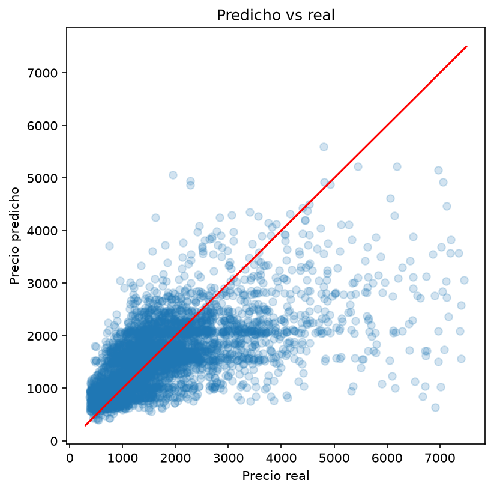

# ¿Qué determina el precio de un Airbnb en CDMX?

Modelo de regresión lineal sobre ~23 mil alojamientos de Airbnb en Ciudad de México para responder:
**¿qué factores explican el precio por noche y cuánto pesa cada uno?**

**Herramientas:** Python (pandas, statsmodels, scikit-learn, matplotlib)
**Datos:** [Inside Airbnb](https://insideairbnb.com/get-the-data/), Ciudad de México (`listings.csv.gz`, fecha de captura: [PON AQUÍ LA FECHA])

## Resultados

El modelo explica cerca de la mitad de la variación del precio (**R² = 0.469** en datos de prueba) y se equivoca en promedio por **$578 MXN** por noche. Los efectos se miden sobre el logaritmo del precio y se leen como % de cambio, con lo demás igual.

- **La zona pesa mucho.** Frente a Azcapotzalco (alcaldía de referencia), Miguel Hidalgo es 74.6% más cara, Cuajimalpa 61.7% y Cuauhtémoc 58.8%. Tláhuac es 30.3% más barata.
- **El tipo de alojamiento es el factor más fuerte.** Una habitación privada cuesta 34.3% menos que un alojamiento completo, y una compartida 58.0% menos.
- **Tamaño:** cada recámara adicional se asocia con +14.7% de precio y cada persona de capacidad con +8.4%.
- **Calificación:** cada punto más en la calificación (escala de 1 a 5) se asocia con +10.3% de precio.
- **Sin diferencia clara** frente a la referencia: Gustavo A. Madero, Xochimilco, Milpa Alta y habitaciones de hotel (p-values altos). La disponibilidad anual casi no influye.

## Limitaciones

- El modelo acierta bien entre $500 y $2,500, pero **subestima los precios altos**: alojamientos de $4,000 a $7,000 se predicen entre $1,500 y $3,500. No ve factores como acabados, vista o ubicación exacta.
- Una mejora futura sería agregar amenidades y coordenadas.
- Son asociaciones, no causas: el modelo no dice que subir la calificación suba el precio.
- Los porcentajes por alcaldía dependen de la referencia elegida (Azcapotzalco).

## Limpieza de datos

- Se eliminó `bathrooms` (100% vacía) y las filas sin precio, recámaras o calificación. Esto deja fuera alojamientos nuevos sin reseñas.
- Se conservaron precios entre $376 y $7,500 (percentiles 1 y 99) para evitar valores extremos, como un máximo de $1.8 millones por noche.
- Se usó el logaritmo del precio, porque la distribución está muy sesgada.
- Se excluyeron alojamientos con más de 6 recámaras o más de 10 personas de capacidad.
- Muestra final: 23,781 alojamientos tras la limpieza, 23,463 en el modelo.

## Estructura del proyecto

- `notebooks/01_limpieza.ipynb`: carga y limpieza de datos.
- `notebooks/02_regresion.ipynb`: modelo, interpretación y evaluación.
- `data/processed/`: datos limpios.
- `images/`: gráficas.

## Cómo reproducirlo

1. Descarga `listings.csv.gz` de Ciudad de México en Inside Airbnb y colócalo en `data/raw/`.
2. Instala las dependencias con `pip install -r requirements.txt`.
3. Ejecuta `01_limpieza.ipynb` y después `02_regresion.ipynb`.